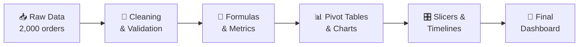

 

 

## 📌 Project Overview

A major data-analytics project that turns **2,000 e-commerce orders** (January 2024 – December 2025) into an **interactive Excel dashboard** for fast, data-driven decisions.

> **🎯 Objective:** Analyze sales performance, profitability, customer behavior and regional trends so stakeholders can act on clear, visual insights.

| 🧾 Orders | 📅 Period | 🗂️ Dataset | 📑 Sheets |
| :---: | :---: | :---: | :---: |
| **2,000** | **Jan 2024 – Dec 2025** | **2,000 rows × 26 columns** | **8** |

---

## 📊 Headline KPIs

| 💰 Net Sales | 📈 Total Profit | 🎯 Profit Margin | 🛍️ Total Orders |
| :---: | :---: | :---: | :---: |
| **₹11.13 Cr** | **₹3.68 Cr** | **~33.1%** | **2,000** |

| ✅ Delivered | 🔄 Returned | ❌ Cancelled |
| :---: | :---: | :---: |
| **66%** | **17%** | **~17%** |

Exact figures: Net Sales ₹11,13,66,542.96 · Profit ₹3,68,90,356.78

---

## ✨ Key Insights

<table>
<tr>
<td width="50%" valign="top">

### 📦 Category Performance
- 🥇 **Fashion** leads in sales (₹23.7M) and profit (₹7.82M)
- 🥈 **Home & Kitchen** follows closely (₹23.0M)
- Also covered: Beauty, Electronics, Sports

### 🌍 Regional Strength
| Rank | State | Sales |
| :---: | :--- | ---: |
| 1 | Delhi | ₹14.5M |
| 2 | Tamil Nadu | ₹12.9M |
| 3 | Telangana | ₹12.0M |
| 4 | Rajasthan | ₹11.5M |

</td>
<td width="50%" valign="top">

### 💳 Payment Trends
- 🏦 **Net Banking** tops at ₹24.3M
- 💵 **Cash on Delivery** is a close second (₹23.8M)
- Also tracked: UPI, Credit Card, Debit Card

### 📅 Monthly Trends
- 24 months of time-series analysis
- 🔥 **Peak months:**
  - July 2024 → ₹5.98M
  - March 2025 → ₹5.96M

</td>
</tr>
</table>

---

## 🛠️ Tech Stack

| 🧰 Tool | 🎯 Purpose |
| :--- | :--- |
| **Microsoft Excel** | Data cleaning, analysis and dashboarding |
| **Pivot Tables & Charts** | Aggregation, summarization and dynamic visuals |
| **Slicers & Timelines** | Interactive filtering by Year, Month, Category and State |
| **Advanced Formulas** | `SUMIFS`, `XLOOKUP`, `IF` for Profit Margin and rate metrics |

---

## 🔄 Project Workflow

---

## 📂 Workbook Structure

**File:** `New_Dashboard_for_IIOT_pROJECT.xlsx`

| # | Sheet | Description |
| :---: | :--- | :--- |
| 1 | 🗃️ `Master_Data` | Cleaned dataset: 2,000 rows × 26 columns |
| 2 | 📦 `Sales_by_Category` | Sales across product categories |
| 3 | 📍 `Sales_by_Location` | Sales by State and City |
| 4 | 📅 `Monthly_Sales` | Net Sales per month |
| 5 | 💳 `Payment_Method_Sales` | Sales distribution by payment method |
| 6 | 💹 `Profitability_by_Category` | Net Sales vs. Profit and margins |
| 7 | 🚚 `Order_Status_Summary` | Delivered, Returned and Cancelled counts |
| 8 | 🎛️ `Final Dashboard for project` | Main interactive dashboard with KPIs and charts |

---

## 🖼️ Dashboard Preview

<!-- Add a screenshot named dashboard-preview.png to the repo, then uncomment the line below -->
<!-- 

 -->

*📸 Dashboard preview coming soon!*

---

## 🚀 How to Explore

1. **⬇️ Download** `New_Dashboard_for_IIOT_pROJECT.xlsx` from this repository.
2. **📂 Open** it in Microsoft Excel 2016 or newer.
3. **✅ Enable** editing and content if the yellow security banner appears.
4. **🎛️ Interact:** open the `Final Dashboard for project` tab and use the slicers to explore.

---

## 👨‍💻 Let's Connect

Questions, feedback, or just want to talk data analytics? Reach out!

 

**⭐ If you found this project helpful, please give it a star! ⭐**

